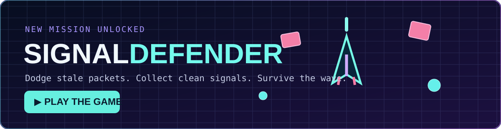

<div align="center">
  
</div>

<div align="center">
  <h2>Code, curiosity, and a little chaos.</h2>
  <p>Mobile engineering · ML systems · retrieval · agents · developer tools</p>
  <p><a href="https://github.com/Laibaali0"><b>GITHUB PROFILE</b></a> &nbsp;·&nbsp; <a href="https://laibaali0.github.io/Laiba-Ali/"><b>INTERACTIVE PORTFOLIO ↗</b></a> &nbsp;·&nbsp; <a href="https://laibaali0.github.io/Laiba-Ali/arcade/"><b>PLAY SIGNAL DEFENDER ↗</b></a></p>
</div>

---

### `> new_game`

<a href="https://laibaali0.github.io/Laiba-Ali/arcade/"></a>

**Signal Defender** is an original HTML Canvas arcade game. Dodge red corrupted packets, catch teal signals, build combos, and try to beat your local high score. It supports keyboard and touch controls, pause, optional audio, and reduced-motion-aware styling. No account or analytics.

**[Game source](docs/arcade/)** · **[Site source](docs/)** · **[Browser-game tests](tests/test_arcade_logic.cjs)**

> **Publishing note:** To make the website and game links live, enable GitHub Pages using **Settings → Pages → Deploy from branch → main /docs**. The game code is already in this repository.

### `> ls projects/`

Practical, small **synthetic-data experiments** for understanding ML evaluation, inference and developer tooling. They are learning artifacts, not production deployments.

| Project | Engineering concepts | Run |
| :--- | :--- | :--- |
| [MerchantPolicy-RL](projects/merchant_policy_rl.py) | Contextual bandits, logged propensities, IPS/SNIPS/DR | `python -m projects.merchant_policy_rl` |
| [FlashServe-4bit](projects/flashserve_4bit.py) | Per-row CPU weight quantization, packing and reconstruction | `python -m projects.flashserve_4bit` |
| [Catalog Retrieval](projects/catalog_retrieval.py) | Synthetic attribute-vector search and recall/MRR evaluation | `python -m projects.catalog_retrieval` |
| [PR Review Assistant](projects/pr_review_assistant.py) | Read-only diff checks and stale-commit validation | `python -m projects.pr_review_assistant` |
| [Test Impact Analyzer](projects/test_impact_analyzer.py) | Conservative static Python import graph | `python -m projects.test_impact_analyzer` |
| [Segmentation Lab](projects/segmentation_lab.py) | Synthetic segmentation masks with Dice/IoU | `python -m projects.segmentation_lab` |

### `> ./run_tests.sh`

```bash
# ML demos
python -m pip install -r requirements.txt
python -m pytest -q

# Arcade mechanics (Node.js 20+)
node --test tests/test_arcade_logic.cjs
```

### `> next_quests`

- Replace toy retrieval features with a licensed public dataset and pretrained encoders.
- Evaluate off-policy estimators across reproducible seeds and publish uncertainty intervals.
- Test quantized inference on a public model and specified GPU; report *measured* performance.
- Add more arcade levels and experiment with input accessibility.

I like learning how things work, asking better questions, and building interfaces that make complicated systems feel simple.

<sub>Portfolio integrity: Example metrics only characterize local synthetic fixtures. These projects include AI-assisted development; they do not include confidential employer code or substantiate unrelated résumé results.</sub>
